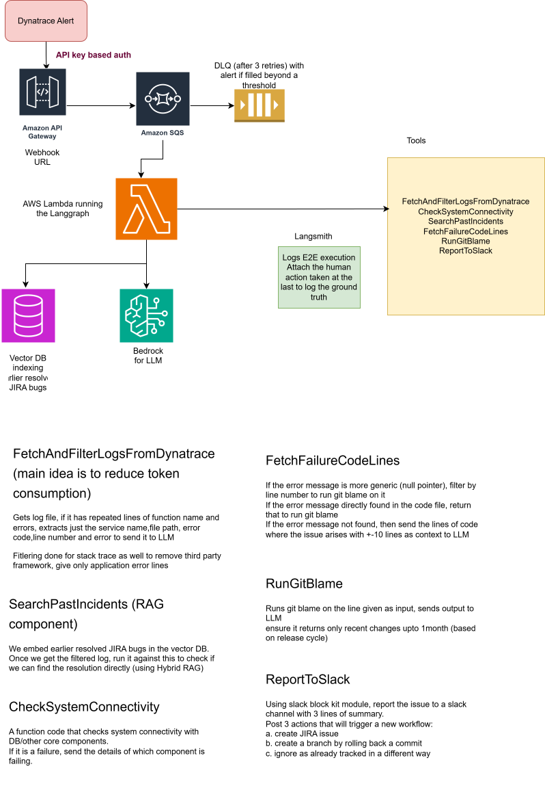

# Incident-triage-agent
This is an AI agent built using LangGraph for automating RCA on application issues sent as alerts from Dynatrace 
Components: LangGraph, AWS API Gateway, AWS Lambda, AWS SQS, Bedrock,Hybrid RAG,Langsmith,Slack with Human approval for further actions  

